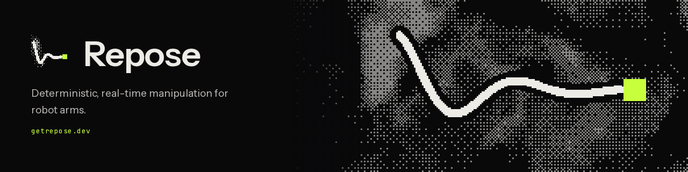

<p align="center">
  <a href="https://getrepose.dev">
    
  </a>
</p>

<p align="center">
  <a href="https://app.codspeed.io/ReposeRobotics/repose?utm_source=badge"></a>
  <a href="https://github.com/ReposeRobotics/repose/actions/workflows/cflite_pr.yml"></a>
  <a href="https://github.com/ReposeRobotics/repose/actions/workflows/cflite_batch.yml"></a>
  <a href="License.md"></a>
</p>

<p align="center">
  <b>Motion, coming to rest.</b><br>
  <a href="https://getrepose.dev">Website</a> ·
  <a href="https://getrepose.dev/get-started">Get started</a> ·
  <a href="https://getrepose.dev/docs">Docs</a> ·
  <a href="ROADMAP.md">Roadmap</a> ·
  <a href="CHANGELOG.md">Changelog</a>
</p>

---

**Repose** by [Repose Robotics](https://reposerobotics.org) is a deterministic,
real-time manipulation stack for robot arms. Kinematics, collision checking,
motion planning, trajectory timing, and control ship as zero-allocation
components for [`copper-rs` (`cu29`)](https://github.com/copper-project/copper-rs).

- **Deterministic.** Built for Copper's record-and-replay. Sampling planners
  draw all randomness from a per-job seed.
- **Real-time.** No heap allocations on the hot path. Joint counts and
  capacities are compile-time constants.
- **Embedded-ready.** The runtime crates build for `no_std` and bare-metal
  targets.
- **Typed.** Angles, lengths, and velocities use SI units in the type system,
  not bare floats.
- **Copper-native.** Every component is a `CuTask` you name directly in RON.
  Nothing is ported from ROS.

## At a glance

| Operation (6-DOF igus ReBeL) | Median |
|---|---|
| Forward kinematics | **312 ns** |
| Differential IK (twist → joint velocities) | **682 ns** |
| Self-collision check, one configuration | **427 ns** |
| Configuration vs 11-obstacle scene | **1.12 µs** |
| Full RRT-Connect planning job | **121 µs** |

These are local wall-clock medians on an Apple M4. Regression tracking runs on
every PR through [CodSpeed](https://app.codspeed.io/ReposeRobotics/repose). The
full table and method are in [docs/benchmarks.md](docs/benchmarks.md).

## Install

Nothing is on crates.io yet. The API is pre-1.0 and may still change, so depend
on a git tag:

```toml
[dependencies]
repose = { git = "https://github.com/ReposeRobotics/repose", tag = "v0.8.3" }
```

The `repose` umbrella crate re-exports every component. You can also depend on
individual crates.

| Repose | Copper (`cu29`) | Rust (MSRV) |
|---|---|---|
| 0.7 – 0.8 (as `repose-*`) | 1.3 | 1.95 |
| 0.1 – 0.6 (as `cu-*`) | 1.3 | 1.95 |

The workspace is versioned and tagged as a whole (`vX.Y.Z`). Before 1.0, a
minor bump can break the Rust API, payload encoding, or RON config; a patch
release never does. See [docs/versioning.md](docs/versioning.md).

## Quick start

Every task is generic over its joint count and capacities, and you name it
directly in RON. Applications don't wrap library tasks:

```ron
(
    id: "planner",
    type: "repose_joint_rrt_star::CuJointRrtStarTask<6>",
    background: true,
    config: {"chain": "igus_rebel", "collision_model": "igus_rebel"},
),
(id: "follower", type: "repose_trajectory::CuFollowTrajectoryTask<6, 1024>"),
```

The [MuJoCo simulator example](examples/mujoco_rebel/README.md) runs the full
goal → plan → time → follow → control loop, configured entirely in RON. Run
`just` in the repository root to list the development tasks.

## Crates

| Crate | What it does |
|---|---|
| [`repose`](components/libs/repose) | Umbrella crate; re-exports everything, plus the MuJoCo bridge behind `mujoco-sim` |
| [`repose-kinematics`](components/libs/repose_kinematics) | FK, space/body Jacobians, DLS and differential IK, servo task, igus ReBeL model |
| [`repose-collision`](components/libs/repose_collision) | Sphere/capsule models, exact signed distance, planning scene, collision tasks |
| [`repose-robot-description`](components/libs/repose_robot_description) | Startup URDF/SRDF import into fixed-size kinematic and collision models |
| [`repose-robot-interface`](components/libs/repose_robot_interface) | Vendor-neutral robot bridge contract: channels and session rules |
| [`repose-trajectory`](components/libs/repose_trajectory) | Fixed-capacity trajectories, timing profiles, Cartesian TCP-zone blending |
| [`repose-motion-planning`](components/tasks/repose_motion_planning) | `CuJointPlanner` contract, anytime planner task, built-in planners |
| [`repose-joint-rrt-star`](components/tasks/repose_joint_rrt_star) | Informed RRT* with rewiring and shortcutting |
| [`repose-controller`](components/tasks/repose_controller) | Position/velocity/effort joint controller with watchdog and rate limiting |
| [`repose-io`](components/tasks/repose_io) | Digital IO payloads and an IO-driven gripper task |

## Documentation

| Guide | Covers |
|---|---|
| [Robot configuration](docs/robot-configuration.md) | Chain presets, inline chains, typed joint units, URDF/SRDF import |
| [Motion planning](docs/motion-planning.md) | The planner contract, choosing a planner, planning-scene snapshots |
| [Pose planning](docs/pose-planning.md) | Pose goals, straight TCP moves, RON wiring |
| [Continuous motion and TCP zones](docs/trajectories.md) | Cartesian blending, timing profiles, follower interpolation |
| [Benchmarks](docs/benchmarks.md) | Method, full results, how to reproduce them |
| [API conventions](docs/api-conventions.md) | Params structs, constructors, units, visibility |
| [Versioning](docs/versioning.md) · [Migration 0.8](docs/migration-0.8.md) | Release policy and upgrade notes |

## Studio

Studio is the private `studio` submodule. Clone with
`git clone --recurse-submodules`, or run `git submodule update --init` in an
existing checkout. You need access to the Studio repository; see
[Studio's README](studio/README.md) for setup.

## Contributing

Read [CONTRIBUTING.md](CONTRIBUTING.md) first. In short, work on a branch, run
`just fmt` and `just pr-check`, and record user-visible changes in
[CHANGELOG.md](CHANGELOG.md).

## License

Apache 2.0. See [License.md](License.md).
